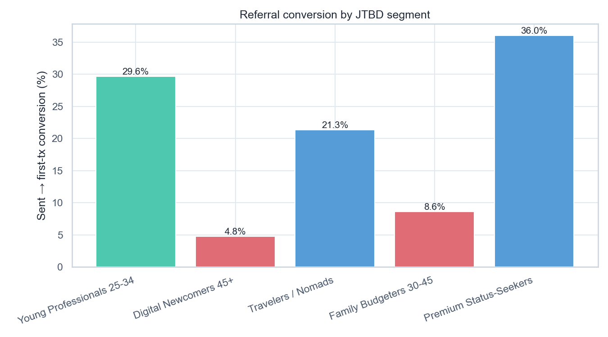

# Volta — Referral Segments

[](https://github.com/NikitaBoyarkin/case-referral/actions/workflows/ci.yml)

[](LICENSE)

Referral funnel by JTBD segment: anchor 29.6% vs Digital Newcomers 45+ 4.8% and families 8.6%. The gap opens at accept, not KYC.

## Key results

- Anchor 29.6% vs 45+ 4.8% and families 8.6%
- Gap at accept (78% vs 26% vs 40%)
- chi² p<0.001; z anchor vs gap = 43.3

## Situation

Referral is the best funnel channel. We test whether it scales beyond the anchor.

## Task

Since referral is the strongest channel in the funnel, my job was to find out whether it holds up outside the anchor segment.

## Actions

- Referral funnel (sent→accepted→KYC→first-tx) by JTBD segment.
- Chi² segment × status, two-proportion z-test anchor vs gap.
- Channel effect within gap segments.

## Result

- **Anchor 29.6%** vs **45+ 4.8%** and **families 8.6%** (chi² p<0.001, z=43.3).
- The gap opens at **accept** (78% vs 26% vs 40%), not at KYC.
- In-app 20.6% vs link 14.3% overall, but within the gap still far below the anchor.

## Recommendations

- Don't scale the referral budget blindly.
- Segment incentives first (assisted for 45+, cashback for families), then expand referral.
- Rework the referral value prop for gap segments.

## Charts



## Dataset

The dataset is fully synthetic, generated by seeded, reproducible script(s) (`scripts/generate_referral_segments_data.py`). No real customer data is used. Running `make data` regenerates the CSV(s) in `data/` with the same random seed, so every number below is reproducible.

## Quick start

```bash
uv sync --all-groups
make data
make run
```

## Project structure

```text
case-referral/
├── README.md
├── LICENSE
├── .gitignore
├── .python-version
├── pyproject.toml
├── Makefile
├── .github/workflows/ci.yml
├── scripts/
│   ├── generate_referral_segments_data.py
│   └── volta_referral_segments.py
├── utils/
│   ├── __init__.py
│   ├── common.py
│   └── viz_helpers.py
├── data/
│   └── volta_referral_segments.csv
├── outputs/
│   ├── referral_conversion_by_segment.png
└── tests/
    └── test_referral_segments.py
```

## Stack

- Python
- pandas / NumPy
- SciPy / Statsmodels
- scikit-learn
- Matplotlib / Seaborn
- uv + ruff

## Links

- [Full case study on the portfolio site](https://nikitaboyarkin.github.io/en/projects/volta/referral/)
- [Parent project — volta-banking](https://github.com/NikitaBoyarkin/volta-banking)
